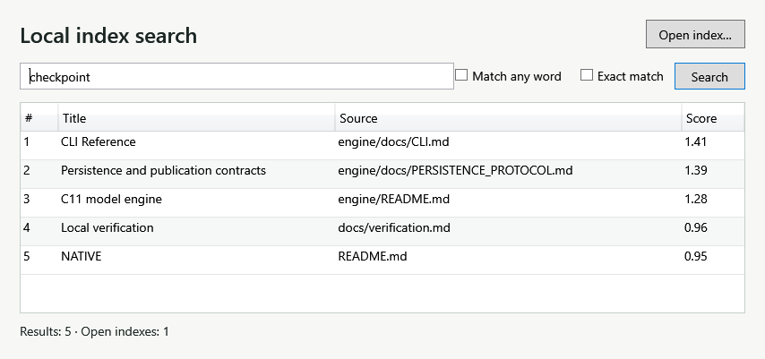

# NATIVE

NATIVE contains an Arabic programming language that compiles to x86-64, two model runtimes written in C, a local text index, and a small BIOS kernel. The language tools and model runtimes run on the host. The kernel boots separately and runs its own memory and matrix checks.

## Build and run

Use x86-64 Linux or WSL. The host build needs C11 and C++17 compilers, static C and math libraries, Make, CMake 3.20 or later, GNU binutils, and NASM. The boot test uses `qemu-system-x86_64`. Build on a Linux filesystem, including when using WSL.

~~~sh
make -j2
lang/niyahrun lang/examples/factorial.niy
build/engine/niyah calc '10/4'
~~~

The interpreter prints `RESULT=720`. The calculator prints `5/2`.

## Search the documentation

This example builds a searchable index from ten Markdown files in the checkout. It records each source path, byte length, and SHA-256 digest. Choose a new output path when creating an index.

~~~sh
sh retrieval/index-docs.sh manual.dalw
retrieval/lowlevel/dalw-cli verify manual.dalw
retrieval/lowlevel/dalw-cli search manual.dalw 5 checkpoint
~~~

`search` requires every parsed term. `search-any` ranks documents containing at least one. Both use the first 32 distinct query terms. Arabic queries use stemming by default. Set `DALW_EXACT=1` for surface forms or `DALW_EXACT=0` for stemming. Its receipts list the query term hashes in `terms` and the hashes present in that document in `matched_terms`. The desktop option is **Match any word**.

`dalw-cli verify SHARD EXPECTED_BODY_SHA256` compares the verified body with a 64-digit hexadecimal digest you kept separately. Use the `sha256` value printed by `verify` on a trusted copy. The final 32 trailer bytes are excluded from the digest. Set `DALW_VERIFY=1` to check the trailer during a command-line search.

Each matching document produces one line of JSON with its title, source, score, and receipt ID. To index your own UTF-8 TSV, use `dalw-cli index OUT.dalw IN.tsv`. Each row contains the source URL, title, source filename, byte offset, byte length, digest, and text. Offsets and lengths are unsigned decimal integers. The first invalid row stops the import. Add `--skip-invalid` to report and skip malformed rows.

### Desktop search

The desktop client opens local `.dalw` files and searches one or more indexes together. It supports Arabic and English. To build on x64 Windows, install the .NET 8 desktop SDK and an x86-64 MinGW C compiler in WSL. Run these commands from a Windows checkout. The build script uses the default WSL distribution and accepts an optional `-Distribution` argument.

~~~powershell
.\retrieval\ui\build.ps1
.\retrieval\ui\Niyah.App\bin\Release\net8.0-windows\Niyah.App.exe --language en
~~~

## Components

| Directory | Contents |
| --- | --- |
| `lang/` | Lexer, scalar type checker, interpreter, Linux ELF compiler, and a fixed-shape tensor frontend |
| `asm/` | Integer matrix kernels, an Arabic morphology codec, exact fractions, and byte-level model programs |
| `engine/` | FP32 transformer, tokenizer, optimizer, training checkpoints, and generation CLI. CPU is the default backend. OpenMP and CUDA are optional |
| `model/` | Raw FP32 model training and inference, a mapped GGUF decoder, and local query and proof tools |
| `retrieval/` | Index builder, search API, command-line tools, and desktop client |
| `hadeed/` | BIOS bootloader and x86-64 kernel with timer interrupts, page and heap allocators, and a signed matrix self-test |

## Verification

~~~sh
make check
make check-memory
~~~

`make check` runs the host tests, compares generated programs with the interpreter, checks static ELF linkage, and boots the kernel in QEMU. `make check-memory` rebuilds the host C and C++ tests with address and undefined-behavior checks. Both commands generate their own test data.

[Architecture](docs/architecture.md) · [Language reference](lang/docs/language.md) · [Engine commands](engine/docs/CLI.md) · [Verification](docs/verification.md) · [License notices](NOTICE.md)
